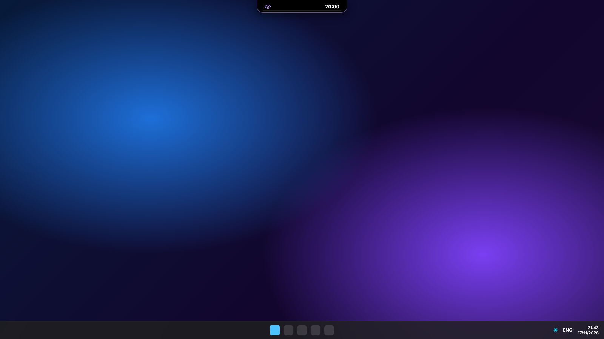
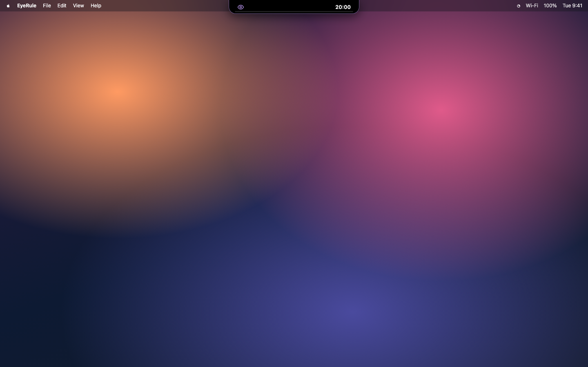
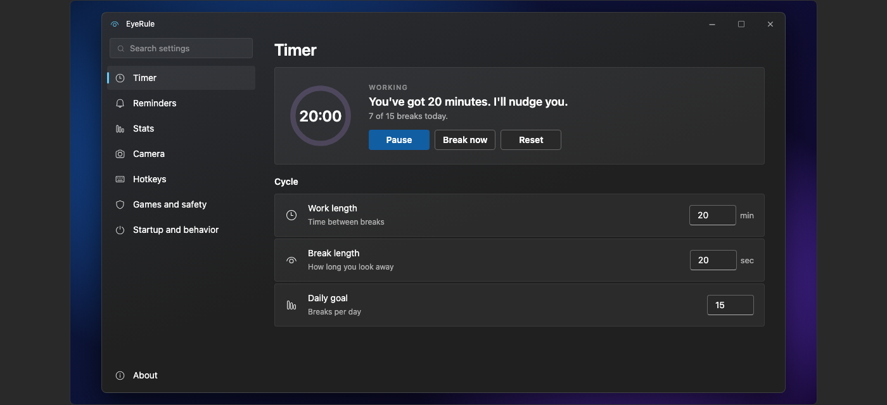
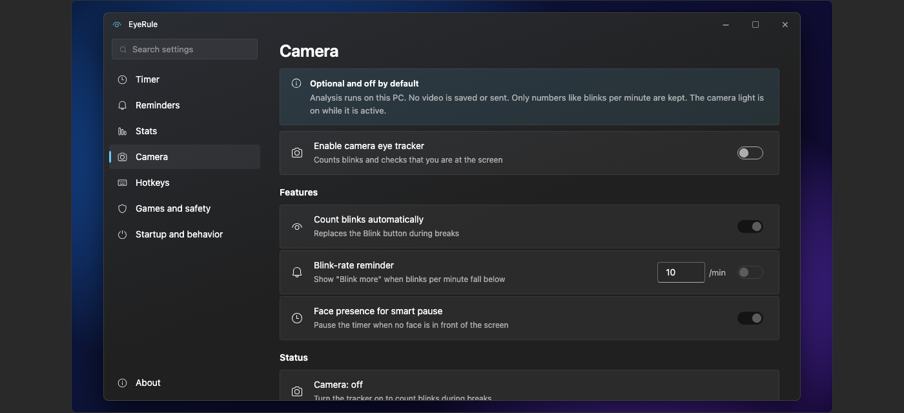
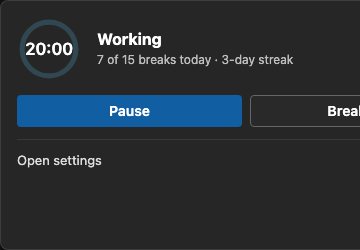

# EyeRule

A 20-20-20 eye-rest reminder for macOS and Windows 11. Every 20 minutes it nudges you to look 20 feet away for 20 seconds, counts your blinks during breaks (optional camera), and tracks your daily streak.

Two apps share the same behavior and visual language:

| Platform | Stack | State |
|---|---|---|
| macOS | Swift + SwiftUI (native notch panel) | Working |
| Windows 11 x64 | Rust + Tauri v2 + React/Fluent UI | Builds; needs on-PC validation |

## On the desktop

| Windows 11 | macOS |
|---|---|
|  |  |

These are desktop-context renders of the UI, not live screenshots. A real Windows capture will be added after the first on-PC run.

## Previews

| Pill | Break card |
|---|---|
|  |  |

| Settings (Windows) | Camera settings | Tray flyout |
|---|---|---|
|  |  |  |

## Features

- Compact pill with countdown, progress line, and time-of-day accent colors; yellow/orange urgency states and a green break state.
- Break card with a breathing ring, rotating prompts, blink counter, Skip, and 5 more minutes. Expands and collapses in place.
- Smart pause on idle or lock, plus optional face presence (camera) so video watching doesn't pause the timer.
- Camera blink counting during breaks: Vision on macOS, MediaPipe Face Landmarker on Windows. Off by default; on-device only.
- Blink-rate reminder when your blink rate drops below a threshold.
- Weekly insights: completed/skipped breaks, break time, and comparison with the previous 7 days (macOS).
- Optional screen dimming during breaks (macOS), dismissed with Esc; skipped in calls and fullscreen apps.
- Stats: daily goal, streak, 7-day chart. Settings for cycle length, sound, reminders, camera, hotkeys, startup.
- Windows: editable global hotkeys (`Ctrl+Alt+S/M/B/E`), tray flyout, launch at login, game-friendly card, anti-cheat safe mode with a manual game list.

## Repository layout

| Path | Contents |
|---|---|
| `Sources/EyeRule/` | Swift macOS app (timer, notch panel, camera tracker, insights, dimming) |
| `Tests/EyeRuleTests/` | Swift unit tests for insights and dimming policy |
| `app/src/` | React/TypeScript UI (pill, break card, settings, tray flyout, MediaPipe runner) |
| `app/src-tauri/` | Rust timer engine, platform adapters, Tauri windows/tray/hotkeys |
| `app/Dockerfile.win` | Linux container that cross-compiles the Windows exe (`cargo-xwin` + `llvm-rc`) |
| `spikes/camera-mac/` | Throwaway Vision blink-rate spike used to pick the sampling rate |

## Build and run

### macOS

```sh
./build.sh          # builds build/EyeRule.app and ad-hoc signs it
open build/EyeRule.app
swift test          # insights and dimming unit tests
```

Requires macOS 13+ and Xcode command line tools.

### Windows (cross-build from macOS)

```sh
cd app
npm ci
npm run build
docker build -t eyerule-win -f Dockerfile.win .
docker run --rm \
  -v "$PWD":/work -v "$PWD/.win-target":/win-target \
  -e CARGO_TARGET_DIR=/win-target eyerule-win
```

The executable is written to `app/.win-target/x86_64-pc-windows-msvc/release/eyerule.exe` (~10 MB). Copy it to a Windows 11 PC and run it; WebView2 is preinstalled. The exe is unsigned, so SmartScreen may ask you to confirm.

You can also develop natively on Windows with `npm run tauri dev` inside `app/`.

### Tests

```sh
swift test                                   # macOS app
cargo test --manifest-path app/src-tauri/Cargo.toml   # Rust engine
```

## Camera and privacy

The camera tracker is opt-in and off by default. Frames are analyzed in memory and discarded; only numbers (blinks, face presence) are kept. Sampling runs in short bursts at about 10 fps so the camera light is not constantly on. The tracker is skipped while another app uses the camera and is off in anti-cheat safe mode.

On Windows the MediaPipe runtime and model are fetched on first enable; later runs use the WebView2 cache. Bundling them for offline use is a possible follow-up.

## Status and limitations

- macOS: the app is in daily use. Weekly insights and the blink-rate reminder are the newest pieces.
- Windows: compiles and cross-builds, but has not yet been run on a Windows PC. Verify the pill over borderless games, hotkeys in-game, anti-cheat safe mode next to each game, camera blink counting, and memory use.
- Anti-cheat safe mode is conservative but cannot guarantee that every anti-cheat accepts every overlay. Games with no detectable anti-cheat process (e.g. VAC) belong on the manual "never show the overlay" list.
- No installer or code signing yet; distribution is a copied `.exe`.
